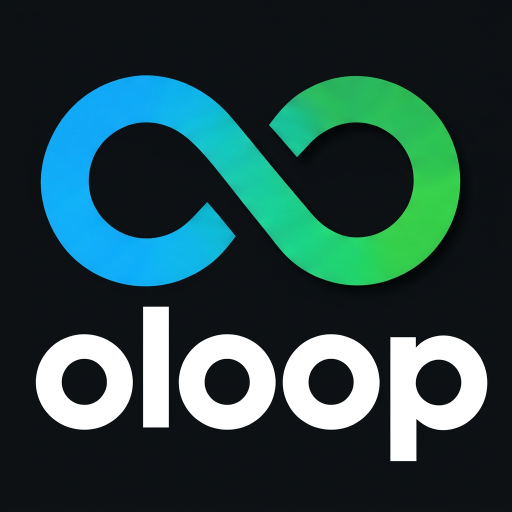

# oloop-android

Android client for [oloop](https://github.com/greebo72/oloop-spec), a local cross-project tracker for todos, questions, decisions, features and bugs. It reads and writes the same Markdown files with YAML frontmatter as the [oloop CLI](https://github.com/greebo72/oloop-cli).

<br clear="all">

## Why this exists

oloop keeps your open points — todos, questions, decisions, features, bugs — as plain Markdown files in one data folder, one folder per project. The CLI works at the desk, the app works everywhere else: on the phone you capture what came up, close to the moment, and the file is already in the same place the CLI will read tomorrow. No account, no sync service, no server. The data folder is usually a synced folder (Syncthing, DAVx⁵, …), and that is the whole sync story.

The hard part of two writers on one folder is not the transport, it is the format. So the format is the contract: `core` is a plain Kotlin/JVM library that parses, validates and writes exactly what the spec defines, refuses what it does not understand, and never touches a file it cannot read. The app is a thin UI on top of it.

Status: `core` is done and tested against the spec fixtures. The `app` module runs on a device (Samsung A53) and the UI follows the Material 3 design spec.

## Modules

| Module | Content |
|---|---|
| `core` | Plain Kotlin/JVM library: parser, writer, behavior rules, conflict check, backup. No Android dependency, so it runs and is tested on any JDK |
| `app` | Jetpack Compose app: folder choice, project list, task list with grouping, editable task detail. `SafFileSystem` implements `OloopFileSystem` on the Storage Access Framework |

`spec/` is the [oloop-spec](https://github.com/greebo72/oloop-spec) repo as a Git submodule. Its schemas and conformance fixtures are the contract. The fixtures run as unit tests.

## What `core` does

- Reads `project.md` and `<project>/tasks/<id>.md`, checks them against the spec rules and refuses files with a newer `formatVersion`. Files it cannot read are reported, not hidden, and never written.
- Writes task files in the same layout as the CLI. Timestamps are plain strings, so they never change.
- `TaskOps` holds the rules: create, edit, close, reopen, comment. Every change needs an actor name and sets `updatedAt` and `updatedBy`. Edit may also change the type; id, `createdAt` and `createdBy` never change.
- `ProjectOps` creates projects: the folder slug follows the CLI's rules (NFKD, casefold, ASCII, `-` runs), including Python's ß→ss casefold. `OloopRepository.createProject` refuses duplicate names and existing folders, writes `project.md` and the empty `tasks/` folder the CLI's atomic writes need.
- `OloopRepository.saveTask` re-reads the file first. If `updatedAt` on disk differs from what the caller loaded, nothing is written and a conflict is returned. Before an existing file is replaced, it is copied to `<project>/.backup/<id>.md.bak`.
- `OloopFileSystem` is the only folder access `core` needs. `JavaFileSystem` implements it for tests and desktop use, the Android app implements it with the Storage Access Framework.
- `Grouping` covers the list-side rules: grouping modes and the "2 h ago" age format, testable without a device.

## The app

- **Folder:** you pick the data folder once in the settings. The app keeps access across restarts. It has no network permission.
- **Screens:** project list, task list with the project name in the header, task detail. On wide screens (840 dp and up) all three show side by side, otherwise they stack with back navigation.
- **Grouping:** none, creation date, modification date, type or status. Closed tasks are hidden unless you switch them on, then they get their own "Closed" section.
- **Editing:** type, title, description (Markdown) and labels in place with an explicit save, close and reopen, comments, new tasks. The app asks for your name before the first write.
- **Projects:** new projects are created from the project list (plus button). The name is turned into the folder name with the same rules as the CLI, and the dialog shows that folder name before you confirm. `referencePath` and `referenceHost` stay empty: a phone has no repository path.
- **Changes from elsewhere:** the app reloads when it comes back to the foreground. If a task changed on disk while you edited it, you choose between reloading and keeping your version.
- **Files that cannot be read** are listed in a warning row and never written.
- **Not done yet:** showing the task image (the path is shown as text).
- **Writes are not atomic.** The Storage Access Framework cannot replace a file by renaming, so an existing file is truncated and rewritten. The old content is copied to `.backup/` first.

## Design

The UI follows a Material 3 spec: flat list rows with a tonal type icon, one filled primary element per screen at most, hierarchy from size and color instead of bold weight, a 4 dp spacing grid.

- **Theme** (`Theme.kt`): a fixed M3 color scheme generated from the seed `#4C5C92`, light and dark, instead of dynamic color — the type containers have to mean what the spec says (todo = `primaryContainer`, feature = `tertiaryContainer`).
- **Type picker** (`Forms.kt`): the two recently used types as chips plus a "+N" chip that opens a searchable bottom sheet with all types. The recent list is persisted on the device, not in the data folder.
- **Forms**: borderless tonal fields with the label inside, labels as input chips, dialogs as tonal `surfaceContainerHigh` sheets with text-button actions.
- **Icon**: the oloop logo (infinity loop over the wordmark on dark navy) as adaptive launcher icon in all densities, as 512 px Play Store listing icon (`store/play_store_512.png`) and as mini logo in the app's top bar. The launcher background is the same navy as the logo square, so round and squircle masks stay seamless.

## Build and test

You need JDK 21. The Gradle wrapper downloads Gradle itself. The app also needs the Android SDK (platform 37 and build tools), which Android Studio installs. Put its location in `local.properties` as `sdk.dir=/path/to/sdk`, Android Studio does that for you.

```
git clone --recurse-submodules git@github.com:greebo72/oloop-android.git
cd oloop-android
./gradlew :core:test           # parser, rules and conformance fixtures
./gradlew :app:assembleDebug   # builds app/build/outputs/apk/debug/app-debug.apk
```

To run the app, open the project in Android Studio and start the `app` configuration on a device or emulator.

To check a real data folder without writing to it:

```
OLOOP_READ_ROOT=/path/to/data ./gradlew :core:test --tests '*ManualChecks*'
```

## History

The first version was generated with Google AI Studio. It stored tasks in the wrong folder and could not read projects with reference fields, so it was replaced. It is still available at commit `5e9af62`.
